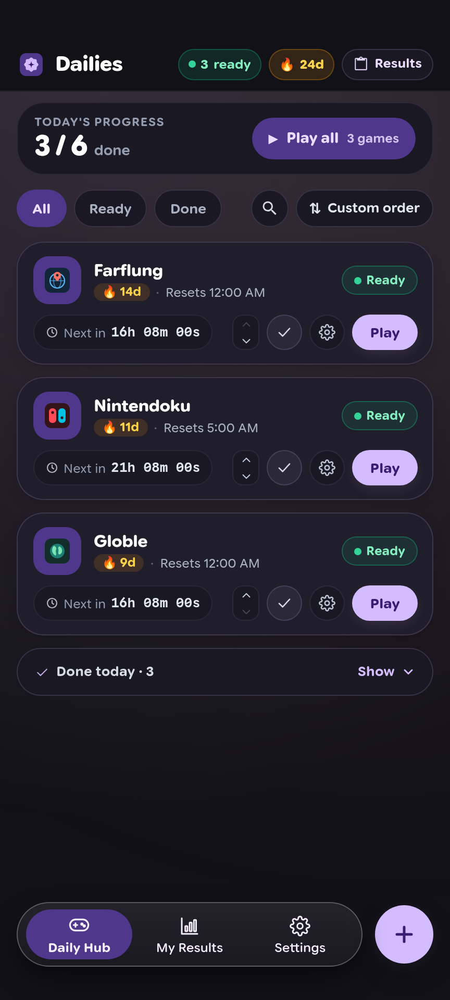
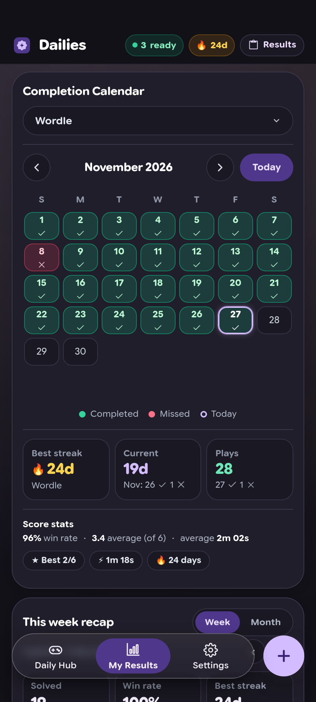
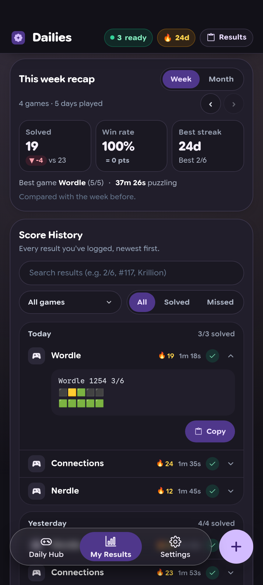
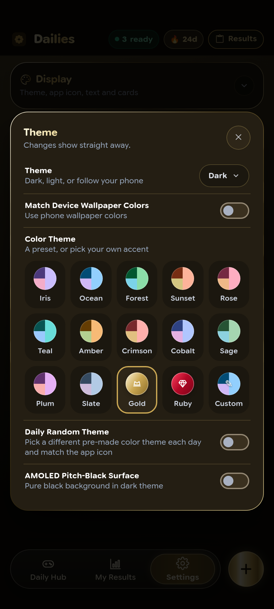
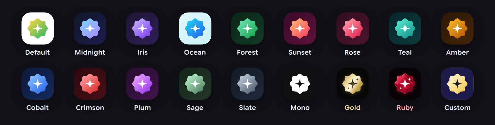

<div align="center">
  
  <h1>Dailies</h1>
  <p><strong>One home for every daily web puzzle you play.</strong><br/>Material 3 Expressive Android app &amp; offline-capable Web PWA — no accounts, no analytics, no ads.</p>
  <p>
    <a href="https://github.com/molamolaguy/Dailies/releases/latest"><strong>Download Latest APK</strong></a> ·
    <a href="https://molamolaguy.github.io/Dailies/"><strong>Open Web App</strong></a> ·
    <a href="RELEASE_NOTES.md">Release Notes</a> ·
    <a href="GUIDE.md">How It Works</a>
  </p>
</div>

<p align="center">
  
  
  
  
</p>

---

## Highlights

- **Add any daily game by link** — Paste or share any URL (or pick from **69 built-in popular daily games** including Wordle, Connections, Strands, Nerdle, Globle, Farflung, Nintendoku, Pokedoku, TimeGuessr, Bandle, and LinkedIn games). Dailies scrapes the live and rendered page to fill in the game's title, icon, category, target format / par, concise how-to-play description, daily reset time, and published time zone, while catching duplicate or redirected game links.
- **Exact time-zone reset clocks & alerts** — Stores each puzzle's reset in the zone the game publishes it in (`local`, `UTC`, fixed `UTC±offset`, or any IANA zone like `America/New_York` or `Europe/Berlin`) and converts it to your phone's local clock across DST changes. Optionally checks weekly for game page updates and suggests schedule fixes if puzzle numbers drift.
- **Play all & ad-free built-in player** — Tap **Play all** to run through every unplayed game in sequence, or switch games from the player's top bar. Includes a built-in blocker (~316,000 ad/tracker domains, 21,500 URL rules, and 42,900 cosmetic rules) with a per-site shield toggle, cookie-banner hiding, dark mode for bright game sites, per-site page zoom, pull-to-refresh, and Wi-Fi asset preloading after reset.
- **Automatic result logging & screenshot OCR** — Quietly captures results when you tap a game's **Share** or **Copy** button or when a game reaches its end screen (including delayed finish animations, word countdowns, `aria-label` buttons, and two-step share menus), while ignoring live in-game progress counters and Unlimited / Practice rounds. For games without a Share button, on-device OCR reads results straight from a screenshot.
- **My Results: calendar, recaps, history & achievements** — Browse a monthly completion calendar per game with current/best streaks, win rate, average score, play time, and personal bests; swipe through weekly and monthly recaps; search and filter day-grouped **Score History**; share all of today's solved results in one formatted digest; and earn **19 two-tier achievements + 5 secret achievements**.
- **Reset notifications & streak reminders** — Get notified right when a game's new puzzle drops (bundled cleanly when multiple games reset together), plus optional global or per-game streak reminders before reset when a streak is on the line.
- **100% local & private** — Everything stays on your device with atomic backups, 60-day **Recent changes** undo, 30-day **Trash**, manual or scheduled weekly `.json` backups, `.csv` history export, and `dailies://add` link / QR code game-list sharing.

---

## Themes, App Icons & Unlockables

Dailies is built with **Material 3 Expressive** typography (`Google Sans Flex`), Dark / Light / Match-phone modes, Android 12+ **Material You** wallpaper colors, pitch-black **AMOLED** surfaces, **12 preset color themes** (Iris, Ocean, Forest, Sunset, Rose, Teal, Amber, Crimson, Cobalt, Sage, Plum, Slate), custom color seeds, and **Daily Random Theme** rotation with matching launcher icons. Earning achievements unlocks the **Brushed Champagne Gold** and **Crystalline Prism Ruby** themes and launcher icons.

<p align="center">
  
</p>

---

## Install (Android 7.0+)

1. Open the **[latest release](https://github.com/molamolaguy/Dailies/releases/latest)** on your phone and download `Dailies-<version>.apk`.
2. Open the downloaded APK and allow installation when Android prompts.

Every public release is signed with the same key, so updates install cleanly over your existing copy and keep all games, streaks, history, and settings.
- **In-app updates**: Turn on **Settings → About → Check for Updates** (or tap **Check now**) to download and install new releases directly inside Dailies.
- **Obtainium**: Point [Obtainium](https://obtainium.imranr.dev/) at `https://github.com/molamolaguy/Dailies` for automatic background update checks.

<details>
<summary>Signing certificate SHA-256</summary>

```text
5F:1C:D5:43:10:F2:A0:B3:10:13:39:7B:C3:2E:34:C2:B4:02:80:10:FF:C3:2E:F9:F9:1F:17:7E:68:B9:1A:BF
```
</details>

---

## Web App (iPhone, iPad & Desktop)

Dailies also runs in any browser as an installable, offline-capable PWA at **[molamolaguy.github.io/Dailies](https://molamolaguy.github.io/Dailies/)**:

- **iPhone / iPad (Safari)**: Tap **Share → Add to Home Screen**, then launch Dailies from your Home Screen for a full-screen standalone app.
- **Desktop & Android browsers**: Use your browser's **Install Dailies** prompt, or bookmark the page.

The web app shares the exact same Daily Hub, **My Results** calendar, stats, recaps, achievements, and themes. Games open in a new tab; when you switch back, Dailies prompts **Finished?** with **Solved / Missed / Paste**. Move data freely between Android and the web app via **Settings → Data & Backup → Save Backup / Import Backup**. Details in [web/README.md](web/README.md).

---

## Build from Source

Requires **JDK 17+**, **Android SDK (API 37)**, and **Node.js 18+** (for Hub JS unit tests and the Web PWA build).

```bash
# Run Kotlin unit tests, Hub JS tests, Android Lint, and build the debug APK
./gradlew testDebugUnitTest testHubJs lintDebug assembleDebug

# Build and verify the zero-dependency Web PWA in dist-web/
node web/build.mjs && node web/check-build.mjs
```

The debug APK is written to `app/build/outputs/apk/debug/`. Architecture details, release signing, CI workflows, and ad-block list compilation (`tools/build_adblock.py`) are documented in [GUIDE.md](GUIDE.md).

---

## License

Licensed under **GPL-3.0** ([LICENSE](LICENSE)). Bundled ad-block filter lists, fonts, and icon assets retain their respective licenses; see [THIRD_PARTY_NOTICES.md](THIRD_PARTY_NOTICES.md).
