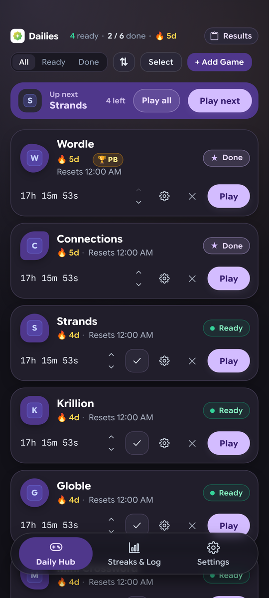
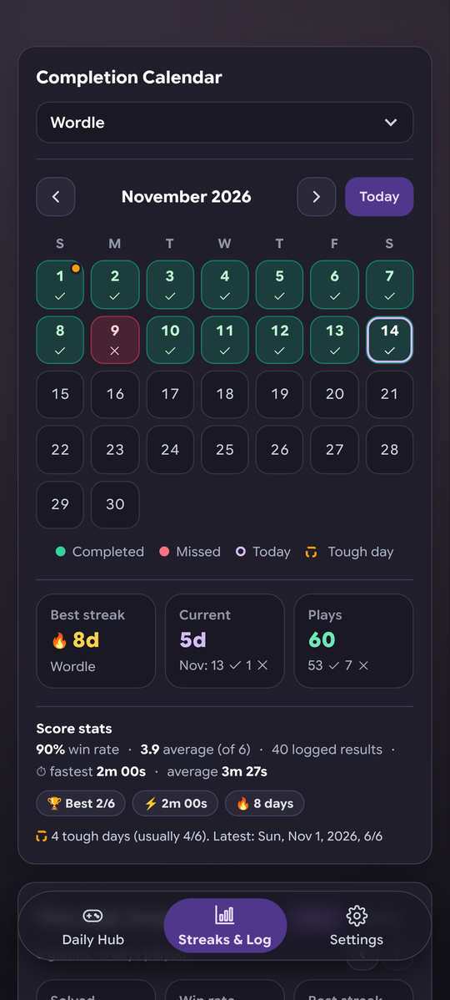
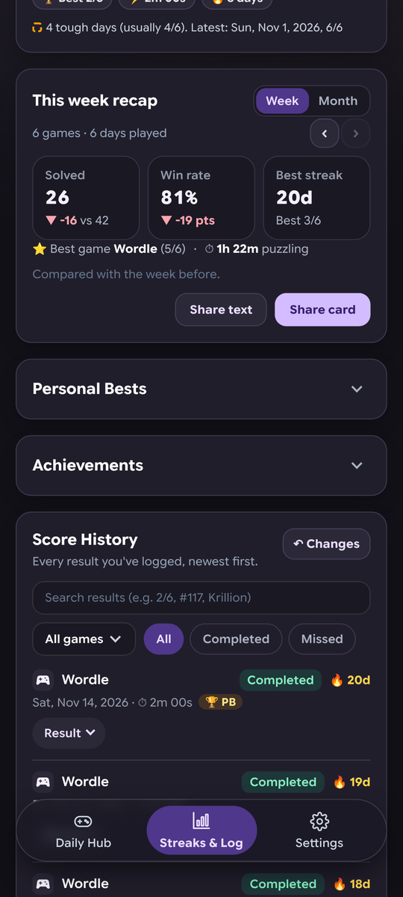
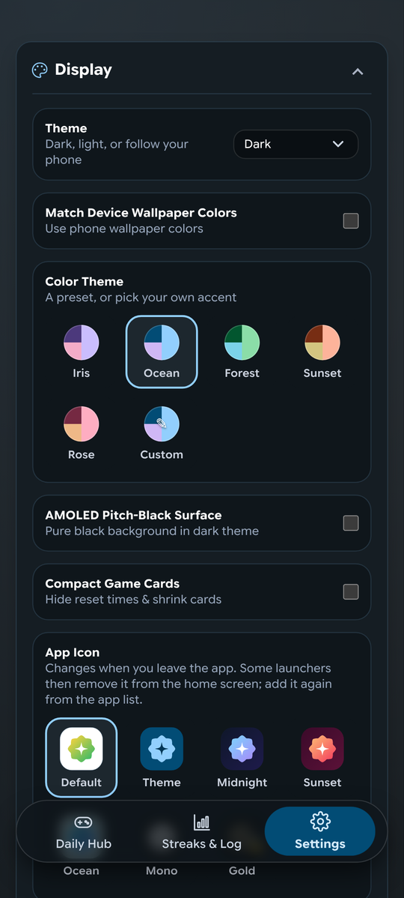

# Dailies

**One home for every daily web puzzle you play.** An Android app with no account and no tracking.

**[Download the latest APK](../../releases/latest)** · Android 7.0+ · **[Open the web app](https://molamolaguy.github.io/Dailies/)** (iPhone, iPad and any browser) · [Release notes](RELEASE_NOTES.md) · [How it works](GUIDE.md)

<p>
  
  
  
  
</p>

## What it does
- **Tracks resets** in each game's own time zone, with a live countdown to the next puzzle.
- **Alerts you** when a new puzzle is out, and can remind you before a streak is lost.
- **Plays games ad-free** in a built-in player.
- **Logs results automatically**: it reads the result from a game's end screen, or when you tap its Share button.
- **Keeps your streaks and stats**: a calendar, win rate, play times, personal bests, achievements and a monthly recap.
- **Reads results from screenshots** for games without a Share button.
- **Light or dark**, with your wallpaper's colors.
- **Keeps your data on your phone**: no server, no analytics. Back up by hand or weekly to a folder you choose, or export a `.csv`.
- **Share your games** with a friend as a link or QR code.

## Install
1. On your phone, open the [latest release](../../releases/latest) and download `Dailies-<version>.apk`.
2. Open the file and allow installing when Android asks.

Updates are signed with the same key, so they install over the previous version and keep your data.
To be told about new versions, turn on **Settings → About → Check for Updates**: the app then offers to download and install them. Or add this repository to [Obtainium](https://obtainium.imranr.dev/) for automatic updates.

<details>
<summary>Signing certificate SHA-256</summary>

```
5F:1C:D5:43:10:F2:A0:B3:10:13:39:7B:C3:2E:34:C2:B4:02:80:10:FF:C3:2E:F9:F9:1F:17:7E:68:B9:1A:BF
```
</details>

## Web app (iPhone, iPad and computers)
Dailies also runs in the browser at **https://molamolaguy.github.io/Dailies/**.
- **iPhone / iPad**: open it in Safari, tap **Share → Add to Home Screen**, then open Dailies from its icon. It runs full screen and works offline.
- **Android / computer**: use your browser's **Install** option, or just bookmark it.

It's the same hub as the Android app: streaks, calendar, stats, recaps, personal bests, achievements and themes. Games open in a new tab; when you come back, Dailies asks whether you finished, and **Paste** logs the result you copied. Automatic result capture, ad blocking and reset alerts need the Android app. Your data stays in that browser on that device; move it with **Settings → Save Backup / Import Backup**. More in [web/README.md](web/README.md).

## Build from source
Needs JDK 17+ and the Android SDK (platform 37). Node.js 18+ is only needed for the JS tests.

```bash
./gradlew testDebugUnitTest testHubJs assembleDebug
```

The APK is written to `app/build/outputs/apk/debug/`. Signed releases, CI and the ad-block lists are covered in [GUIDE.md § 5](GUIDE.md#5-building-from-source).

## License
GPL-3.0 ([LICENSE](LICENSE)). Bundled filter lists, fonts and icons keep their own licenses; see [THIRD_PARTY_NOTICES.md](THIRD_PARTY_NOTICES.md).
